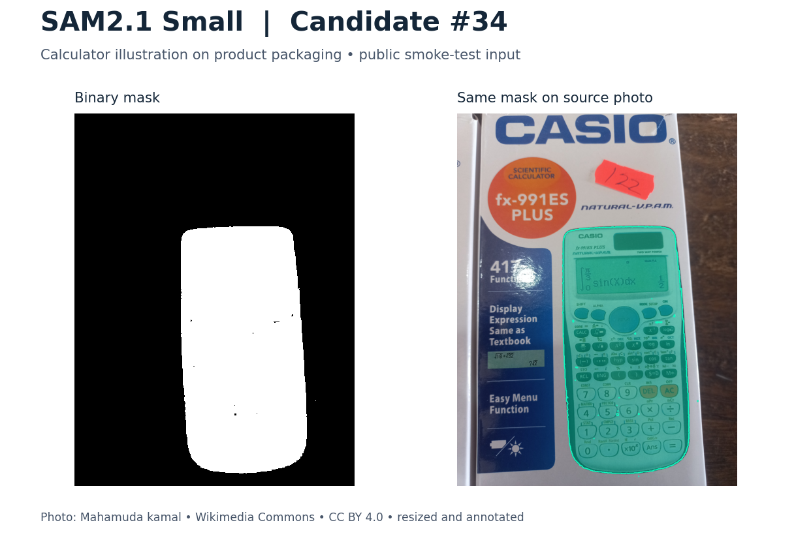
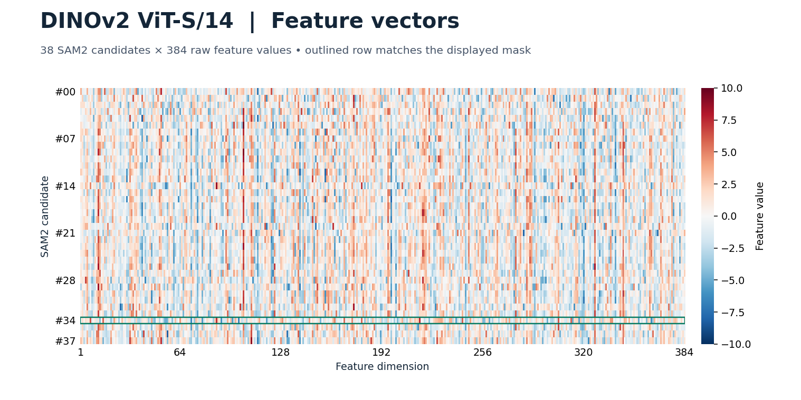

# 모델 실행 검증

Mac M4 CPU, Python 3.12.14, PyTorch 2.5.1에서 SAM2.1 Small과 DINOv2 ViT-S/14를 실행했다. 새 가상환경에서 설치와 `pip check`를 확인했다.

| 확인 항목 | 결과 |
| --- | --- |
| 공개 계산기 포장 사진 | SAM2 마스크 38개, DINOv2 특징 `38 × 384`, 전체 값이 유한함 |
| 공식 트럭 예제 | 마스크 17개, 특징 `17 × 384`. 부분 후보가 먼저 나와도 전체 트럭 후보 `#06`이 후처리 뒤 남음 |
| 자동 테스트 | 11개 통과. 마스크 중복 제거 회귀, 데이터 분할 누출, 가상 벡터 분류기 실행 포함 |

아래 사진은 후보 `#34`에 해당하는 마스크다. SAM2가 포장에 인쇄된 계산기 그림 영역을 분리한 사례다.



사진 [Scientific calculator casio.jpg](https://commons.wikimedia.org/wiki/File:Scientific_calculator_casio.jpg), Mahamuda kamal, [CC BY 4.0](https://creativecommons.org/licenses/by/4.0/). 크기를 조정하고 SAM2 마스크와 윤곽선을 표시했다. 원본 SHA-256은 `446f63b2ba10301f4507b5290e21f81f69b7cdeeba88dec53f6626cf702d2dd8`이다.



테두리로 표시한 `#34` 행이 위 마스크에 대응한다. 이 값은 DINOv2 특징이며, 공개 사진 실행 결과는 분류기 미지정 상태인 `review`다. 승인된 자료로 진행할 실제 분류와 반납 판단 성능은 [#18](https://github.com/mackerel07/opensourcebasic/issues/18)에서 평가한다.

[후처리 뒤 남은 트럭 전체 이진 마스크](sam2-truck-regression.png) · [SAM2 공식 입력 사진](https://github.com/facebookresearch/sam2/blob/2b90b9f5ceec907a1c18123530e92e794ad901a4/notebooks/images/truck.jpg)

## 재현 방법

저장소 루트에서 실행한다. Python 3.12가 필요하다.

```bash
cd model
bash setup.sh
.venv/bin/python -m pip check
MPLBACKEND=Agg .venv/bin/python -m unittest -v test_core.py
.venv/bin/python infer_scene.py --image sample/truck.jpg --device cpu --outdir runs/truck
curl -fL -A 'opensourcebasic-model-smoke/1.0 (https://github.com/mackerel07/opensourcebasic)' \
  'https://upload.wikimedia.org/wikipedia/commons/c/cc/Scientific_calculator_casio.jpg' \
  -o sample/calculator.jpg
.venv/bin/python infer_scene.py --image sample/calculator.jpg --device cpu --outdir runs/calculator
```

각 출력 폴더의 `mask_*.png`와 `candidate_features.npy`에서 원본 결과를 볼 수 있다. 다시 실행할 때는 새 출력 폴더를 사용한다.
